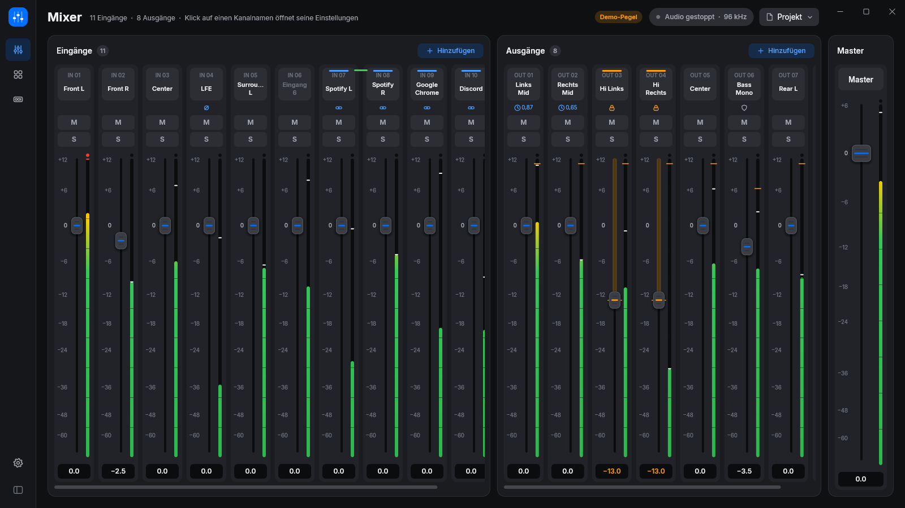
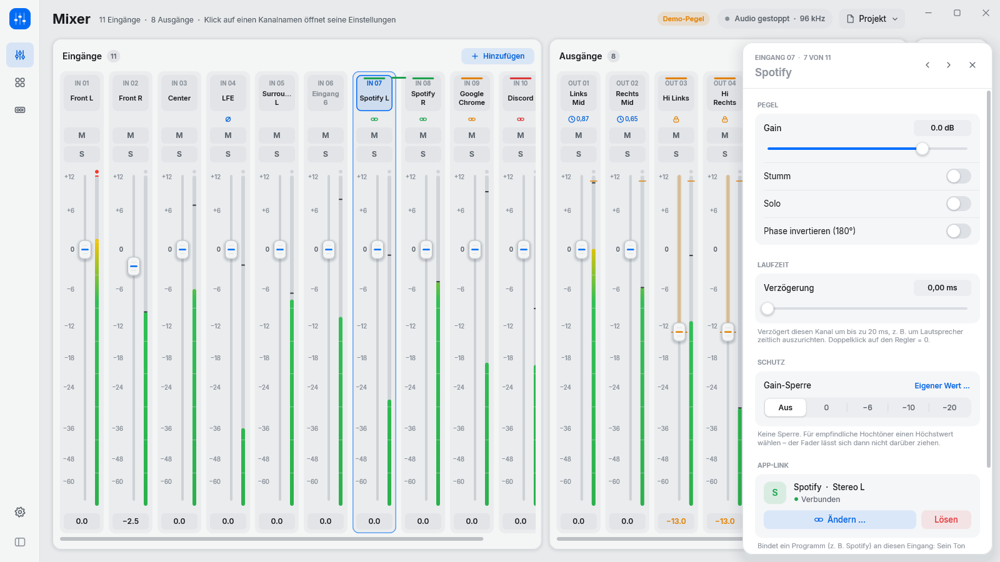
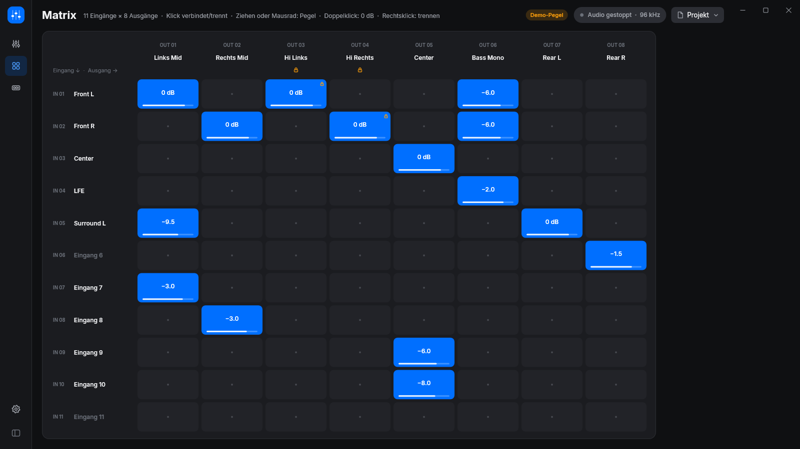
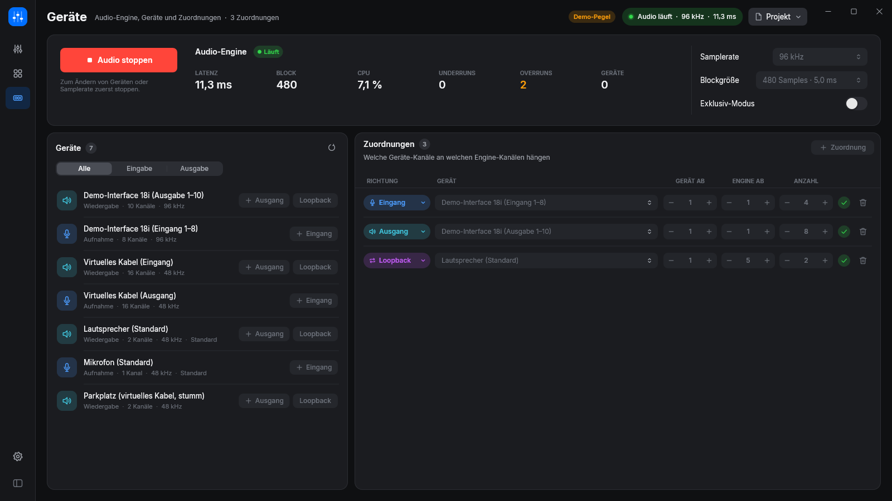
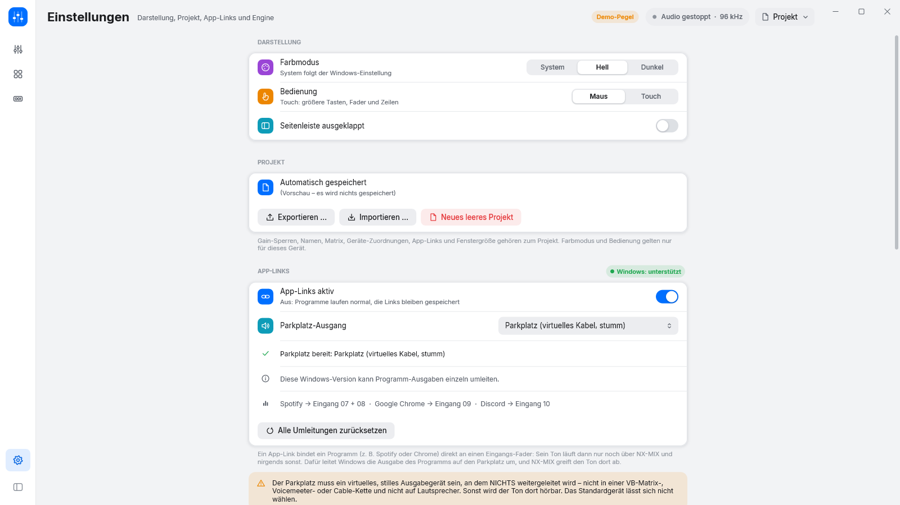

<div align="center">

# NX-MIX

**Audio-Mixer und Routing-Matrix für Windows.**
Eingänge mischen, auf beliebige Ausgänge verteilen, Lautsprecher schützen.

[](https://github.com/nexoGroups/NX-MIX/actions/workflows/ci.yml)
[](https://github.com/nexoGroups/NX-MIX/releases/latest)
[](LICENSE.txt)


[**Installer herunterladen**](https://github.com/nexoGroups/NX-MIX/releases/latest/download/NxMix-win-Setup.exe) ·
[Alle Versionen](https://github.com/nexoGroups/NX-MIX/releases) ·
[Fehler melden](https://github.com/nexoGroups/NX-MIX/issues)



</div>

NX-MIX nimmt Audio von deinen Windows-Geräten auf, mischt es wie ein Mischpult und gibt es auf beliebige Ausgänge aus, zum Beispiel auf mehrere Lautsprecher, Endstufen oder virtuelle Kabel. Jeder Eingang lässt sich über die Matrix mit eigenem Pegel auf jeden Ausgang legen. Für empfindliche Lautsprecher wie Hochtöner gibt es pro Kanal eine Gain-Sperre.

Die kostenlose Nutzung ist an die [Projektlizenz](LICENSE.txt) gebunden: erlaubt für private, nichtkommerzielle Zwecke.

## Funktionen

### Mixer

- **Eingänge, Ausgänge und Master** nebeneinander, mit Fadern von −∞ bis +12 dB, Mute und Solo.
- **Pegelanzeigen** mit Spitzenwert-Halten und Clip-Anzeige.
- **Kanal-Einstellungen** per Klick auf den Kanalnamen: Name, Gain, Phase invertieren, Laufzeit (Delay bis 20 ms), Verschieben und Löschen.
- **Stereo-Paare** lassen sich in einem Schritt anlegen.

### Schutz für Lautsprecher

- **Gain-Sperre** pro Kanal: Fader, Mausrad und Eingabe gehen nicht über den gesperrten Wert.
- **Limiter-Grenze** pro Ausgang, sichtbar als Marke am Meter.
- Matrix-Punkte auf stark gesperrte Ausgänge bleiben bei höchstens 0 dB.
- **Audio startet nie automatisch.** Vor dem ersten Start einer Sitzung fragt NX-MIX nach und zeigt die gesetzten Sperren.

### Matrix

- Raster aus Eingängen × Ausgängen: Klick verbindet oder trennt, Ziehen oder Mausrad stellt den Pegel, Doppelklick setzt 0 dB.

### Geräte

- Windows-Audiogeräte (WASAPI) als Eingänge und Ausgänge zuordnen, auch mehrkanalig.
- **Loopback:** abgreifen, was ein Wiedergabegerät gerade abspielt.
- Samplerate von 44,1 bis 192 kHz, Blockgröße von 128 bis 1024 Samples, wahlweise Exklusiv-Modus.

### VB-CABLE in der Beta

Das Beta-Setup und Beta-Updates enthalten das unveränderte VB-CABLE-Paket von VB-Audio. Beim ersten Start der installierten Beta öffnet sich das Hersteller-Setup, falls VB-CABLE fehlt. Bestätige die Windows-Administratorabfrage, schließe die Treiberinstallation ab und starte Windows neu.

Wähle für das gewünschte Programm **CABLE Input** als Windows-Ausgabegerät. NX-MIX liest **CABLE Output** direkt als Aufnahmegerät und richtet dafür unter **Virtual I/O** einmalig den Eingang **VB-CABLE** ein. Verbinde den Eingang in der Matrix mit deinen gewünschten Ausgängen.

VB-CABLE ist Donationware. Hersteller, Download und freiwillige Unterstützung findest du bei [VB-Audio](https://vb-audio.com/Cable/).

### App-Links

- Ein Programm (z. B. Spotify oder ein Browser) direkt an einen Eingangs-Fader binden. Sein Ton läuft dann nur noch über NX-MIX.
- Dafür braucht es ein stilles virtuelles Ausgabegerät als „Parkplatz“ und Windows 11 bzw. Windows 10 ab Build 20348. NX-MIX setzt alle Umleitungen beim Beenden und nach einem Absturz beim nächsten Start zurück.

### Bedienung

- Hell, Dunkel oder automatisch nach Windows.
- **Maus- oder Touch-Bedienung:** Touch macht Fader, Tasten und Zeilen größer.
- Das Projekt wird automatisch gespeichert und lässt sich als Datei exportieren und importieren.

<p align="center">
  
  
</p>
<p align="center">
  
  
</p>

## Installieren und aktualisieren

1. [NxMix-win-Setup.exe](https://github.com/nexoGroups/NX-MIX/releases/latest/download/NxMix-win-Setup.exe) herunterladen und starten. Die .NET-Laufzeit ist enthalten.
2. NX-MIX sucht beim Start im Hintergrund nach einer neuen Version. Gibt es eine, erscheint oben die Schaltfläche **„Update“**. Geladen und installiert wird nur auf deinen Klick. Du wählst, ob NX-MIX sofort neu startet oder das Update beim Beenden installiert. Die Suche lässt sich in den Einstellungen abschalten.

Das Projekt liegt in `%AppData%\NX-MIX` und bleibt bei Updates erhalten.

Windows zeigt beim ersten Start eventuell eine SmartScreen-Warnung, weil der Installer nicht signiert ist („Weitere Informationen“ → „Trotzdem ausführen“).

## Selbst bauen

Voraussetzung ist das .NET 10 SDK.

```powershell
dotnet build NxMix.slnx
dotnet test NxMix.slnx
dotnet run --project src/NxMix.App
```

Der Selbsttest der Oberfläche läuft ohne Fenster und ohne Audio:

```powershell
dotnet src/NxMix.App/bin/Debug/net10.0-windows/NX-MIX.dll --selftest selftest.txt
```

Installer und Update-Pakete baut `tools/pack.ps1` (braucht `dotnet tool install -g vpk --version 1.2.161`). Veröffentlicht wird über einen Git-Tag `vX.Y.Z`; GitHub Actions testet, baut und veröffentlicht das Release.

## Lizenz

NX-MIX steht unter einer [Lizenz für nichtkommerzielle Nutzung](LICENSE.txt). Fremdkomponenten und ihre Lizenzen: [THIRD-PARTY.md](THIRD-PARTY.md).
